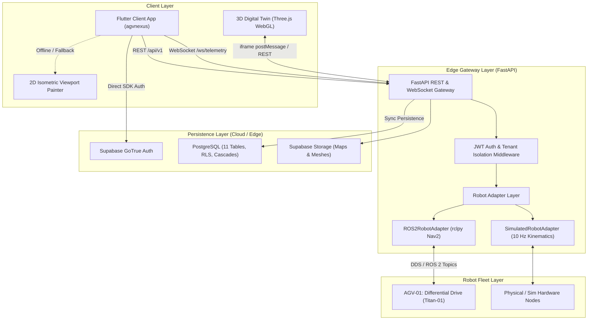
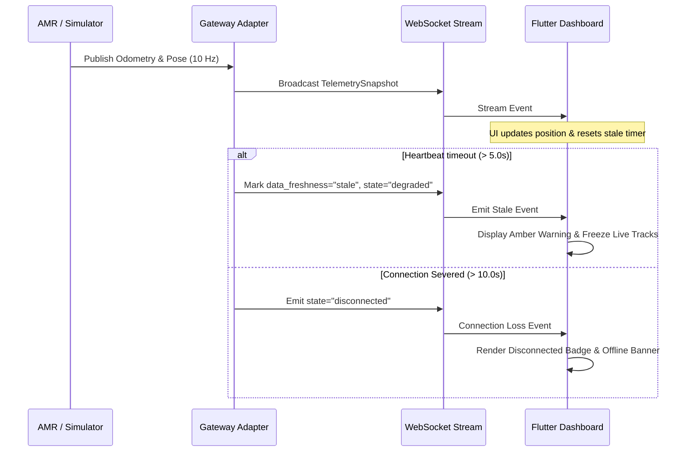

# AGV Nexus: System Architecture & Data Flow

**Document Version**: 1.0.0 (Phase 5 Production Readiness)  
**Classification**: Engineering Architecture Specification  
**Status**: Authoritative  

---

## 1. System Overview & Layered Architecture

AGV Nexus is a high-reliability autonomous mobile robot (AMR) fleet monitoring and mission dispatch platform. The platform connects cross-platform client interfaces (Flutter Web/Desktop/Mobile) with real or simulated ROS 2 AMRs and Supabase persistence through an asynchronous FastAPI Robotics Gateway.

---

## 2. Core Subsystems

### 2.1 Flutter Presentation Architecture
- **State Management**: Riverpod 3.3.2 with unidirectional data flow and automatic lifecycle management (`StateNotifierProvider`, `StreamProvider`, `FutureProvider`).
- **Routing**: `go_router` 17.2 with route-level authentication guards (`/sign-in`, `/robots`, `/robots/:id`, `/digital-twin`, `/missions`, `/settings`).
- **Design System**: Industrial high-contrast dark theme (`NexusTheme`) complying with WCAG 2.1 AA accessibility standards.
- **Fail-Soft Visualizer**: When WebGL fails to initialize or hardware acceleration is unavailable, the UI seamlessly falls back to the native Flutter `IsometricViewportPainter`.

### 2.2 FastAPI Robotics Gateway (`backend/`)
- **Runtime**: Python 3.13 / FastAPI asynchronous ASGI server.
- **Security Middleware**:
  - `security_and_request_id_middleware`: Enforces request correlation IDs (`X-Request-ID`), execution time profiling (`X-Response-Time-Ms`), payload size guard (`MAX_REQUEST_BODY_BYTES = 2MB`), and security headers (`X-Content-Type-Options`, `X-Frame-Options`, `Referrer-Policy`).
  - `SensitiveDataRedactingFilter`: Masks authorization headers, raw JWTs, and passwords from console logs.
- **API Surface**:
  - `/health/live`: Process liveness probe.
  - `/health/ready`: Deep dependency readiness (adapter health and database connectivity).
  - `/api/v1/robots`: Fleet status, telemetry, connection state, manual teleop commands.
  - `/api/v1/robots/{id}/map`: 2D occupancy grid retrieval with origin transformations.
  - `/api/v1/robots/{id}/missions`: Idempotent mission order dispatch and status tracking.
  - `/api/v1/stations`: Factory stations and coordinates.
  - `/ws/telemetry`: High-frequency real-time WebSocket telemetry stream (10 Hz).

### 2.3 3D Digital Twin Viewer (`viewer/`)
- **Technology**: Three.js r128 WebGL renderer mounted statically at `/viewer`.
- **Coordinate Transformations**:
  - ROS 2 REP-103 convention: Right-handed, $X$-forward, $Y$-left, $Z$-up.
  - Three.js convention: Right-handed, $X$-right, $Y$-up, $Z$-backward.
  - Transformation formulas:
    $$\begin{aligned}
    X_{\text{Three}} &= -Y_{\text{ROS}} \\
    Y_{\text{Three}} &= Z_{\text{ROS}} \\
    Z_{\text{Three}} &= -X_{\text{ROS}} \\
    \theta_{\text{Three}} &= -\theta_{\text{ROS}} + \frac{\pi}{2}
    \end{aligned}$$
- **Resource Management**: Textures, geometries, materials, and requestAnimationFrame loops are tracked and cleanly disposed of on canvas unmount.

---

## 3. Data Flow & Security Boundaries

### 3.1 Authentication & Authorization Flow
1. **User Authentication**: Client authenticates with Supabase Auth (or development persona for offline testing).
2. **Token Transmission**: Client attaches `Authorization: Bearer <JWT>` to REST requests or passes `token` in query parameter during WebSocket handshake.
3. **Gateway Verification**: `decode_supabase_jwt` validates token expiration (`exp`), subject (`sub`), role, and tenant metadata (`organization_id`).
4. **Tenant Isolation**: Every resource query is scoped strictly to `user.organization_id`. Cross-organization requests return `403 Forbidden`.
5. **Role-Based Access Control (RBAC)**:
   - `viewer`: Read-only access to status, telemetry, maps, and missions. Denied from dispatching missions (403) and issuing teleop velocity commands (403).
   - `operator`: Can dispatch missions, acknowledge alerts, and issue teleop velocity commands.
   - `engineer` / `admin` / `owner`: Full fleet management and station configuration access.

### 3.2 Telemetry & Staleness Lifecycle

---

## 4. Hardware Safety Boundaries & Interlocks

> [!CRITICAL]
> **Safety Boundary Mandate**:
> The AGV Nexus Flutter UI, FastAPI cloud/edge gateway, and WebSocket communication channels are strictly non-deterministic supervisory monitoring interfaces.
> They are **NEVER** a substitute for certified physical hardware emergency stops, safety laser scanners (PL-d / SIL 2), or onboard safety PLCs complying with ISO 3691-4 / ISO 13849.
