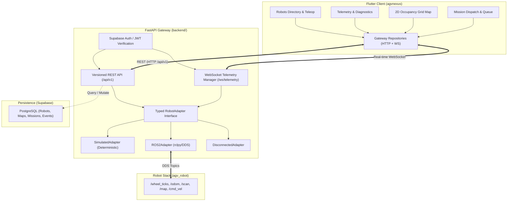

# Phase 3 Implementation Plan: Backend Engineering, FastAPI Integration & ROS 2 Connectivity

## 1. Existing System Audit & Findings

### 1.1 Mobile & Desktop Application (`agvnexus/`)
* **Framework**: Flutter 3.35.7 / Dart 3.9.2.
* **State Management**: Riverpod (`flutter_riverpod: ^3.3.2`).
* **Routing**: GoRouter (`go_router: ^17.2.3`).
* **Authentication**: Supabase Auth (`supabase_flutter: ^2.18.3`) with mock fallback persona switcher.
* **Database & Persistence**: Supabase PostgreSQL client in `SupabaseRobotRepository`, `SupabaseMissionRepository`, etc.
* **Configuration**: `AppConfig` (`agvnexus/lib/core/config/app_config.dart`) specifies `apiBaseUrl` (`http://localhost:8000/api/v1`), `wsBaseUrl` (`ws://localhost:8000/ws/telemetry`), and `isSimulatedMode` flag.
* **Map Rendering**: `OccupancyGridPainter` in `lib/features/maps/presentation/widgets/occupancy_grid_painter.dart` with CustomPainter, metric grid lines, obstacle boxes, station pins, and differential drive chassis.
* **Test Suite**: 27 unit and widget tests passing (`agvnexus/test/`).

### 1.2 Database & Supabase Schema (`supabase/`)
* **Multi-tenant Organization Model**: `organizations`, `organization_members` with roles (`owner`, `admin`, `operator`, `engineer`, `viewer`).
* **Tables**: `organizations`, `profiles`, `organization_members`, `robots`, `factory_maps`, `stations`, `missions`, `mission_events`, `robot_alerts`, `robot_telemetry`, `audit_logs`.
* **RLS & Security Policies**: Row Level Security enabled on all tables, helper functions (`is_org_member`, `is_org_admin`, `is_org_operator_or_higher`).
* **Seed Data**: Organization `a0eebc99-9c0b-4ef8-bb6d-6bb9bd380a11` ("Nexus Gigafactory Alpha"), robots `Titan-01` (`b0eebc99-9c0b-4ef8-bb6d-6bb9bd380b01`), `Atlas-02`, `Hermes-04`, map `c0eebc99-9c0b-4ef8-bb6d-6bb9bd380c01`, stations (Warehouse Bay A, Assembly Line 4, Charging Dock 01, Quality Inspection 2).

### 1.3 Robotics Stack (`agv_robot/`)
* **Robot Type**: Differential-drive Autonomous Mobile Robot (`mobile_robot`).
* **Kinematics**: Wheel diameter $D = 0.10\text{ m}$, wheel track $L = 0.35\text{ m}$, encoder resolution $900\text{ ticks/rev}$.
* **Odometry Node**: `encoder_odometry.py` subscribing to `/wheel_ticks` (`Int32MultiArray` [left, right]) and publishing `/odom` (`nav_msgs/Odometry`) + TF `odom -> base_footprint`.
* **Sensors**: 2D LiDAR mounted at $z = 0.45\text{ m}$ above `base_link` ($0.50\text{ m}$ ground), topic `/scan` ($720$ samples, $10\text{ Hz}$, $0.10\text{ m} - 12.0\text{ m}$ range), OAK-D Pro camera.
* **Mapping**: `slam_toolbox` online async (`config/mapper_params_online_async.yaml`), resolution $0.05\text{ m/cell}$ publishing `/map` (`nav_msgs/OccupancyGrid`).
* **Motion Control**: Standard differential drive velocity command topic `/cmd_vel` (`geometry_msgs/Twist`).
* **Host Environment Status**: Host is Windows with WSL2 Ubuntu. Native `ros2` is not in Windows system PATH. In accordance with safety rules, real hardware connectivity is marked unverified, and we provide an isolated `ros2` adapter plus deterministic `simulated` and `disconnected` adapters with explicit `source: simulated` markers.

---

## 2. Architecture & Integration Plan

---

## 3. Implementation Steps

1. **Backend Package & Foundation (`backend/`)**:
   - `backend/app/config.py`: Pydantic Settings for port, origins, Supabase URL/key, adapter mode (`simulated`, `ros2`, `disconnected`), staleness thresholds.
   - `backend/app/main.py`: FastAPI app, structured logging, CORS, error handlers, `/health/live` and `/health/ready`.
2. **Security & Supabase Auth Verification (`backend/app/core/security.py`)**:
   - Verify Supabase JWT access tokens (signature, expiration, audience/issuer).
   - Enforce organization membership and role checks.
3. **Data Schemas (`backend/app/schemas/`)**:
   - Typed models for Robot Status, Telemetry, 2D Occupancy Grid, Mission Request/Response, WebSocket event envelopes (`robot.telemetry`, `robot.pose`, `robot.map`, `robot.status`, `robot.connection`).
4. **Robot Adapters (`backend/app/adapters/`)**:
   - `base.py`: Abstract `RobotAdapter` protocol.
   - `simulated_adapter.py`: Deterministic simulation based on `agv_robot` specifications (differential drive kinematics, wheel ticks, odometry, 2D SLAM grid, simulated LiDAR scan).
   - `ros2_adapter.py`: Real ROS 2 adapter with isolated rclpy node integration.
   - `disconnected_adapter.py`: Explicitly unavailable mode.
5. **REST API Endpoints (`backend/app/api/v1/`)**:
   - `/health/live`, `/health/ready`
   - `/api/v1/robots`, `/api/v1/robots/{robot_id}/status`, `/api/v1/robots/{robot_id}/telemetry`
   - `/api/v1/robots/{robot_id}/map`, `/api/v1/robots/{robot_id}/missions` (GET & POST)
   - `/api/v1/robots/{robot_id}/connection`, `/api/v1/robots/{robot_id}/teleop`
6. **Real-time WebSocket Manager (`backend/app/services/connection_manager.py`)**:
   - Authenticated WebSocket at `/ws/telemetry` and `/api/v1/ws`.
   - Bounded queues, client subscription tracking, heartbeat ping/pong, graceful disconnects.
7. **Coordinate Transforms & 2D Occupancy Grid Transport**:
   - Map coordinate math: World $(x, y) \leftrightarrow$ Grid cell $(col, row) \leftrightarrow$ Flutter Canvas.
   - Test corners, center, and rotations.
8. **Flutter Client Integration (`agvnexus/`)**:
   - Add `http` / `web_socket_channel` to `agvnexus/pubspec.yaml`.
   - Implement `GatewayRobotRepository`, `GatewayTelemetryRepository`, and `TelemetryWebSocketClient`.
   - Wire telemetry stream to Riverpod providers (`selectedRobotTelemetryProvider`, `connectionStateProvider`).
   - Wire 2D Map to real/simulated occupancy grid.
   - Wire mission dispatch to POST `/api/v1/robots/{id}/missions`.
9. **Testing & Verification**:
   - Pytest suite covering health, auth, schemas, transforms, REST endpoints, and WebSocket.
   - Flutter tests covering API clients, WebSocket parsing, coordinate transforms, and UI states.
