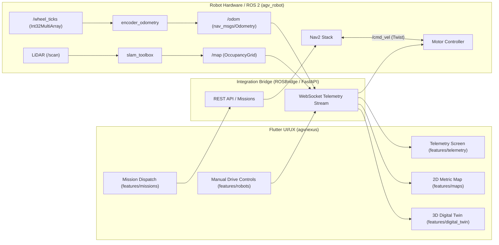

# AGV Robot Code Analysis & UI/UX Integration Roadmap

## 1. Executive Summary

This document provides a comprehensive technical breakdown of the autonomous robot codebase cloned from [`https://github.com/code100percent/agv-nexas.git`](https://github.com/code100percent/agv-nexas.git) into `agv_robot/`, and outlines the architectural plan to integrate it with the `agvnexus/` Flutter UI/UX command center.

Both systems are isolated into clean, decoupled directories to ensure easy analysis, independent development, and safe future merging:
- **`agvnexus/`**: Industrial Flutter Command Center (Desktop, Web, Mobile).
- **`agv_robot/`**: ROS 2 Autonomous Robot Stack (URDF, Odometry driver, SLAM, Gazebo arena).

---

## 2. In-Depth Analysis of Robot Stack (`agv_robot/`)

### 2.1 Technology Stack & Structure
The robot code is a **ROS 2** workspace containing the `mobile_robot` metapackage:
```
agv_robot/mobile_robot/
├── config/
│   ├── factory_arenas2.sdf               # Gazebo Harmonic 3D industrial simulation environment
│   └── mapper_params_online_async.yaml   # slam_toolbox 2D LiDAR online async SLAM parameters
├── mobile_robot_driver/                  # ROS 2 Python Driver Package
│   ├── launch/driver.launch.py           # Driver launcher
│   ├── mobile_robot_driver/
│   │   └── encoder_odometry.py           # Differential-drive dead reckoning & TF publisher
│   └── package.xml                       # Depends: rclpy, nav_msgs, geometry_msgs, std_msgs, tf2_ros
└── robot_description/                    # ROS 2 Robot Model & Visualization Package
    ├── launch/display.launch.py          # State publisher & RViz2 launcher
    ├── rviz2/mobile_robot.rviz           # RViz visualization config (Grid, RobotModel, TF)
    ├── urdf/mobile_robot.urdf            # Precise physical geometry, links, joints & sensors
    └── package.xml
```

### 2.2 Physical Robot & Kinematic Specifications

| Parameter | Value | Source File | Notes |
| :--- | :--- | :--- | :--- |
| **Drive Architecture** | Differential Drive (2 powered rear wheels + passive casters) | `mobile_robot.urdf` | Planar ground vehicle |
| **Wheel Diameter ($D$)** | $0.10\text{ m}$ ($10\text{ cm}$, radius $0.05\text{ m}$) | `encoder_odometry.py:17` | Direct measure |
| **Wheel Track ($L$)** | $0.35\text{ m}$ ($35\text{ cm}$) | `encoder_odometry.py:18` | Distance between wheel contact points |
| **Encoder Resolution** | $900.0\text{ ticks/rev}$ | `encoder_odometry.py:19` | Quadrature ticks per wheel revolution |
| **Counter Wrap** | $2^{32}$ | `encoder_odometry.py:20` | Handles 32-bit integer overflow safely |
| **Meters per Tick** | $\approx 0.000349\text{ m/tick}$ ($\frac{\pi \times 0.10}{900}$) | `encoder_odometry.py:111` | High-precision resolution |

### 2.3 Sensor Array & Frame Topology

1. **2D Safety & Navigation LiDAR**:
   - Link: `lidar_link` mounted at $(x=0, y=0, z=0.45\text{ m})$ relative to `base_link` ($0.50\text{ m}$ above ground plane).
   - Topic: `/scan` (`sensor_msgs/LaserScan`).
   - Specs: $720$ samples, $10\text{ Hz}$, Range $0.10\text{ m}$ to $12.0\text{ m}$, Field of View $360^\circ$ ($-\pi$ to $+\pi$).
2. **Depth Camera**:
   - Link: `camera_link` & `camera_optical_frame` (Luxonis OAK-D Pro form factor).
   - Position: Mounted on front edge of top plate $(x=0.17, y=0, z=0.46\text{ m})$.
3. **Coordinate Frame Tree (TF2)**:
   $$\text{map} \xrightarrow[\text{slam\_toolbox}]{} \text{odom} \xrightarrow[\text{encoder\_odometry}]{} \text{base\_footprint} \xrightarrow[\text{fixed}]{} \text{base\_link} \to [\text{middle\_plate}, \text{top\_plate}, \text{lidar\_link}, \text{camera\_link}, \text{wheels}]$$

### 2.4 Active ROS 2 Topics & Message Types

| Topic Name | Message Type | Publisher Node | Subscriber Node | Purpose |
| :--- | :--- | :--- | :--- | :--- |
| `/wheel_ticks` | `std_msgs/Int32MultiArray` | Motor Microcontroller (ESP32/STM32/Arduino) | `encoder_odometry` | Raw cumulative encoder counts `[left_ticks, right_ticks]` |
| `/odom` | `nav_msgs/Odometry` | `encoder_odometry` | Nav2 / SLAM Toolbox | Estimated position $(x, y)$, heading $(\theta/\text{yaw})$, and velocities $(v_x, \omega_z)$ |
| `/tf` | `tf2_msgs/TFMessage` | `encoder_odometry`, `robot_state_publisher` | SLAM / RViz / Navigation | Dynamic transforms `odom -> base_footprint`, etc. |
| `/scan` | `sensor_msgs/LaserScan` | LiDAR driver / Gazebo sensor | `slam_toolbox` | Obstacle distance points for 2D SLAM and costmaps |
| `/map` | `nav_msgs/OccupancyGrid` | `slam_toolbox` | RViz / UI Map Viewer | Dynamic 2D metric grid map (resolution: $0.05\text{ m/cell}$) |
| `/cmd_vel` | `geometry_msgs/Twist` | UI Teleop / Nav2 Planner | Motor controller | Target linear velocity ($m/s$) and angular velocity ($rad/s$) |

---

## 3. UI/UX Feature Alignment with Robot Capabilities

The `agvnexus` Flutter application has built-in features that correspond directly to this robot setup:



### Feature-by-Feature Integration Plan:

1. **2D Map & Live Pose (`agvnexus/lib/features/maps`)**:
   - *Current UI*: Flutter `CustomPainter` renders a metric grid, obstacles, station markers, and AMR location.
   - *Robot Integration*: Connect to `/map` (`nav_msgs/OccupancyGrid` from `slam_toolbox`). Convert the 1D int8 array of occupancy values $(-1\text{ to }100)$ into the Flutter canvas bitmap. Plot the robot's real-time pose from `/odom`.
2. **Telemetry Dashboard (`agvnexus/lib/features/telemetry` & `robots`)**:
   - *Current UI*: Displays linear speed, angular rate, battery, position coordinates, and wheel ticks.
   - *Robot Integration*: Ingest `/odom` for $v_x, \omega_z, x, y, \text{yaw}$ and `/wheel_ticks` for raw left/right encoder readings.
3. **Manual Joystick / Teleop (`agvnexus/lib/features/robots`)**:
   - *Current UI*: On-screen touch/keyboard manual teleoperation controls.
   - *Robot Integration*: Publish `geometry_msgs/Twist` messages to `/cmd_vel` with `linear.x` and `angular.z`.
4. **Mission Dispatch & Navigation (`agvnexus/lib/features/missions`)**:
   - *Current UI*: Mission queue with stations (Charging Dock, Pickup Bay, Dropoff Point).
   - *Robot Integration*: Send target waypoint coordinates $(x, y, \text{yaw})$ as a Nav2 goal (`NavigateToPose` action or `/goal_pose`).
5. **3D Digital Twin (`agvnexus/lib/features/digital_twin`)**:
   - *Current UI*: Three.js / isometric spatial viewer.
   - *Robot Integration*: Use the dimensions from `mobile_robot.urdf` (or export the URDF to `.gltf` / `.glb`) to display the real differential drive robot with its chassis, wheels, middle shelf, and LiDAR cylinder.

---

## 4. Bridge Options for UI-Robot Communication

Since Flutter cannot run native DDS C++ binaries directly on all platforms (especially Web and Mobile), standard robotics architecture uses a lightweight bridge:

### Option A: `rosbridge_server` (Zero-Code Gateway)
- Run `ros2 launch rosbridge_server rosbridge_websocket_launch.xml` (port 9090).
- In Flutter, connect using standard Dart `web_socket_channel` or `roslib` package.
- Directly subscribe to `/odom`, `/map`, `/scan` and publish to `/cmd_vel`.

### Option B: FastAPI Gateway (`docs/architecture.md` model)
- A Python FastAPI server runs as a ROS 2 node.
- It digests heavy ROS 2 topics, filters telemetry at 20–30 Hz, and serves clean JSON/binary WebSockets to the Flutter UI while persisting events to Supabase.

---

## 5. Next Steps

1. **Phase 1 (Completed)**: Decouple the codebase into clean `agv_robot` and `agvnexus` root directories with documentation.
2. **Phase 2**: Run simulation testing with `factory_arenas2.sdf` and verify `/odom` and `/scan` output.
3. **Phase 3**: Connect the Flutter telemetry repository to a live WebSocket bridge to replace simulated mock data with real ROS 2 streams.
